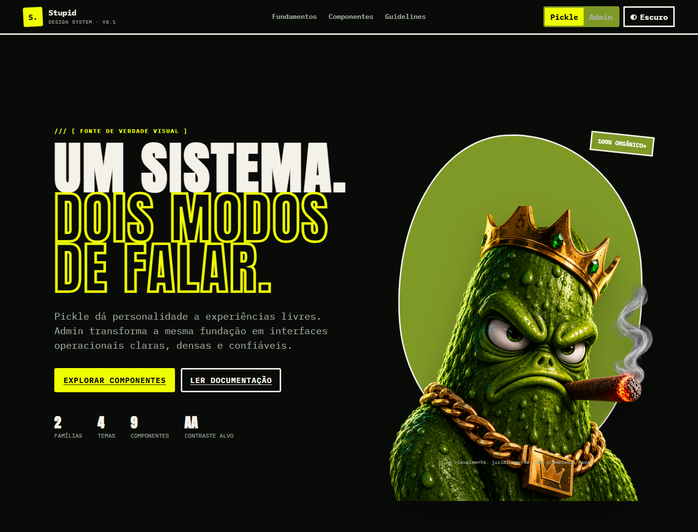

# Stupid Design System

Fonte de verdade visual compartilhada da **Stupid.DLL**. Um núcleo, duas vozes:

- **Pickle / Livre** — expressivo, ácido e deliberadamente estranho. Usa oliva de pepino, lima elétrica, ciano, magenta, papel e preto. Ideal para portfólio, campanhas, labs e experiências autorais.
- **Admin / Painéis** — preciso, contido e profissional. Mantém o verde como assinatura, usa superfícies neutras, densidade previsível e aliases compatíveis com shadcn/ui.



> A vitrine em `docs/` permite alternar ao vivo entre Pickle/Admin e Light/Dark.

## Começo rápido

```bash
npm install @stupid-dll/design-system
```

```css
@import "@stupid-dll/design-system";
```

Defina família e modo no elemento raiz:

```html
<html data-brand="pickle" data-theme="dark">
<!-- ou -->
<html data-brand="admin" data-theme="light">
```

```html
<button class="sd-button sd-button--primary">Salvar mudança</button>
```

Sem pacote publicado, clone o repositório, execute `npm run build` e importe `dist/stupid-design-system.css`.

## Estrutura

```text
tokens/       cores, tipografia, spacing, radius, borders, shadows, motion e grid
themes/       decisões semânticas por família e modo
src/          CSS fonte e componentes
dist/         artefatos gerados pelo build
components/   contrato, anatomia, estados e exemplos
guidelines/   cor, tipografia, layout e acessibilidade
docs/         vitrine navegável sem framework
assets/brand/ personagens e referências visuais
```

## Princípios

1. **Semântico antes de literal.** Componentes usam `--sd-color-action-primary`, nunca `--sd-pickle-500`.
2. **Personalidade com propósito.** Pickle pode inclinar e gritar; fluxos críticos continuam legíveis.
3. **Admin não é genérico.** O verde da marca aparece em ação, foco e seleção — não em toda superfície.
4. **Acessibilidade é contrato.** Foco visível, alvos de 44px e movimento reduzível são padrão.
5. **Um componente, dois sotaques.** A anatomia e a API não mudam ao trocar o tema.

## Contrato de temas

| Atributos | Uso |
| --- | --- |
| `data-brand="pickle" data-theme="light"` | Editorial claro e expressivo |
| `data-brand="pickle" data-theme="dark"` | Portfólio/lab de alto contraste |
| `data-brand="admin" data-theme="light"` | Painéis e backoffice padrão |
| `data-brand="admin" data-theme="dark"` | Operação prolongada em baixa luz |

Aliases `--background`, `--foreground`, `--primary`, `--border`, `--ring`, etc. são expostos em HSL para integração com Tailwind/shadcn. Veja [guidelines/shadcn.md](guidelines/shadcn.md).

## Desenvolvimento

```bash
npm run build
npm run check
npm run preview
```

Abra `http://localhost:4173/docs/`. O build é determinístico e não requer dependências.

## Status

Versão inicial `0.1.0`. Tokens e componentes podem evoluir até `1.0.0`; mudanças incompatíveis serão registradas em `CHANGELOG.md`.

